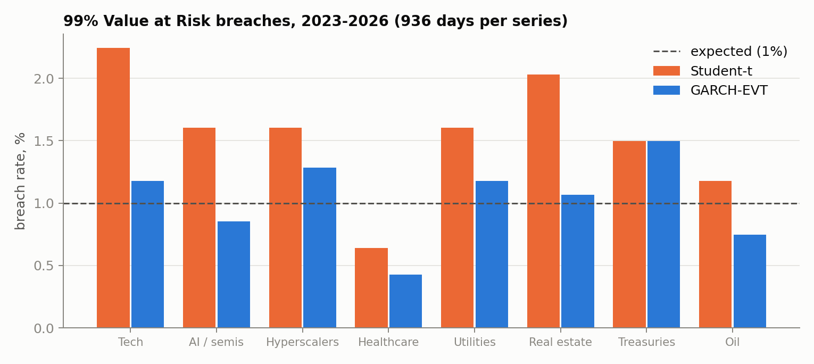
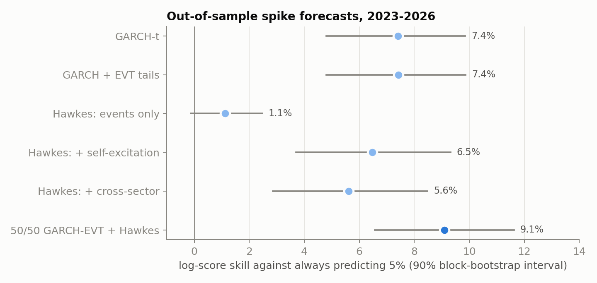

# Sector Event Risk Models

How likely is a large one-day move in each sector, and how much of it comes from scheduled events (CPI, jobs reports, FOMC, earnings)? Three model families, scored on the same unseen days, January 2023 to September 2026.

Research only, not investment advice.

Series: Tech (XLK), semis (SMH), a hyperscaler basket (MSFT, GOOGL, AMZN, META, ORCL), Healthcare (XLV), Utilities (XLU), Real estate (XLRE), S&P 500 (SPY), Treasuries (TLT) and Oil (USO).

## The models

1. **GJR-GARCH(1,1) with Student-t errors** (`spikes.py`), with each scheduled date's variance scaled by an event multiplier shrunk toward the pooled mean (empirical Bayes).
2. **GARCH-EVT** (`evt.py`): GJR-GARCH fitted on 2015-2022 only, with generalised Pareto tails on the standardised residuals, losses and gains fitted separately.
3. **Multivariate Hawkes** (`hawkes.py`): a spike in one series raises the chance of spikes in the next days, in itself and the others, with event days in the baseline. Fitted by maximum likelihood from several starting points, with cross-sector links tested by likelihood ratio and a Benjamini-Hochberg correction.

A spike is a day beyond the series' 95th-percentile absolute move over 2015-2022.

## Results

**Event days** (`history.py`). Variance on event days against ordinary days, 2015 to 2026 (FOMC from 2021), with a bootstrap 90% interval:

| | CPI | Jobs report | FOMC |
|---|---|---|---|
| S&P 500 (SPY) | 0.98 [0.76, 1.24] | 1.36 [1.03, 1.74] | 2.58 [1.18, 4.68] |
| Tech (XLK) | 0.93 [0.73, 1.16] | 1.32 [1.01, 1.69] | 1.47 [0.98, 2.04] |
| Real estate (XLRE) | 1.46 [1.08, 1.92] | 1.01 [0.72, 1.38] | 1.85 [0.94, 3.07] |
| Utilities (XLU) | 1.23 [0.98, 1.51] | 1.42 [0.92, 2.02] | 1.12 [0.65, 1.69] |

FOMC days matter most for the index, CPI matters for the rate-sensitive sectors but not for SPY or tech, and earnings move the hyperscaler basket far more than any macro release (about 6.4 times ordinary variance on MSFT and GOOGL report days, 3.4 to 3.5 after shrinkage).

**Value at Risk, 2023-2026** (936 days per series, 16 tests at 99% and 99.5%):

| Model | Fails Kupiec (coverage) | Fails Christoffersen (independence) | Fails both together |
|---|---|---|---|
| Student-t | 4 of 16 | 0 of 16 | 4 of 16 |
| EVT tails | 1 of 16 | 0 of 16 | 0 of 16 |



Most loss tails have a positive EVT shape parameter (about +0.14 to +0.19 for tech, hyperscalers, real estate, Treasuries and oil), meaning power-law tails. The Student-t model's breaches don't bunch together (it passes independence everywhere), so its volatility dynamics are fine and its tail shape is what's wrong.

**Contagion.** The Hawkes branching ratio is 0.85, and self-excitation is strongest in oil (0.52), Treasuries (0.49) and healthcare (0.43), fading with a half-life of about 3 to 7 days. Only 3 of 56 cross-sector links survive the correction: healthcare to tech, real estate to utilities, and tech to semis.

**Out-of-sample spike forecasts** (`compare.py`), as skill against always predicting 5%, with a 20-day block bootstrap:

| Model | Log-score skill [90% interval] |
|---|---|
| GARCH-t | 7.4% [4.8%, 9.9%] |
| GARCH-EVT | 7.4% [4.8%, 9.9%] |
| Hawkes, events only | 1.1% [-0.1%, 2.5%] |
| Hawkes + self-excitation | 6.5% [3.7%, 9.3%] |
| Hawkes + cross-sector | 5.6% [2.9%, 8.5%] |
| **50/50 GARCH-EVT + Hawkes** | **9.1% [6.6%, 11.6%]** |



Volatility clustering carries most of the skill; the event calendar alone barely beats a constant. The blend is best because the two families get different days wrong. No model beats the constant for utilities.

**Q4 2026 forecasts** (made at the September 25, 2026 close): probability of at least one spike day between October 1 and December 31.

| Series | Spike threshold | GARCH-EVT | Hawkes | Past quarters with one |
|---|---|---|---|---|
| Tech (XLK) | 3.04% | 67.9% | 78.9% | 61.4% |
| AI / semis (SMH) | 4.05% | 82.2% | 87.6% | 75.0% |
| Hyperscalers | 3.24% | 80.7% | 88.4% | 79.5% |
| Healthcare (XLV) | 2.15% | 74.8% | 70.6% | 59.1% |
| Utilities (XLU) | 2.23% | 86.1% | 83.7% | 77.3% |
| Real estate (XLRE) | 2.47% | 73.7% | 75.9% | 65.9% |
| Treasuries (TLT) | 1.78% | 73.7% | 74.5% | 65.9% |
| Oil (USO) | 5.00% | 80.9% | 75.4% | 70.5% |

Both models sit above the historical rate for every series, since the quarter held the election, two FOMC meetings and the main earnings season. These can be scored once the quarter ends.

## Limitations

- The 2026 election multiplier (3.7) is an assumption taken from SPY options.
- FOMC history here starts in 2021 (46 meetings).
- The 50/50 blend was scored on the same test days that suggested it.
- One Hawkes decay rate per target series.

## Running it

```bash
pip install -r requirements.txt
python history.py && python spikes.py && python evt.py && python hawkes.py && python compare.py
python tests/test_models.py      # no market data needed
```

The options step (`implied.py`, `implied_precise.py`) needs Alpaca keys in `.env`; its outputs are already in `results/`. Prices come from Yahoo and are cached in `cache/`.

| Path | What it is |
|---|---|
| `history.py`, `spikes.py` | event multipliers and the GARCH model |
| `evt.py` | GARCH-EVT tails and VaR back tests |
| `hawkes.py` | multivariate Hawkes fit and tests |
| `compare.py` | out-of-sample scoring |
| `tests/test_models.py` | 9 tests, including recovery of planted Hawkes parameters |

Tested with Python 3.13, arch 8.0, numpy 2.2 and scipy 1.16.
